# Captures du prototype Néréide

Captures navigateur de la galaxie, des systèmes et du terrain. Les aperçus ci-dessous montrent la version avec zoom continu.

| Vue | Mobile | Bureau |
| --- | --- | --- |
| Galaxie | 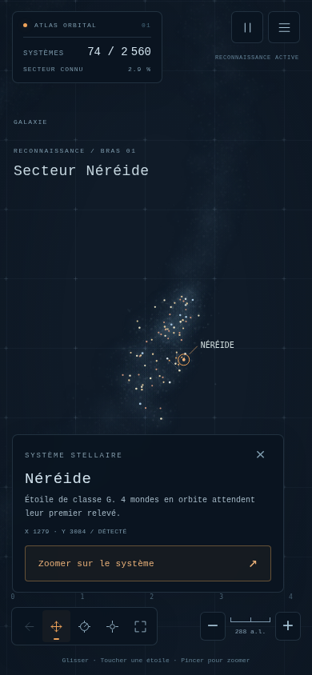 | 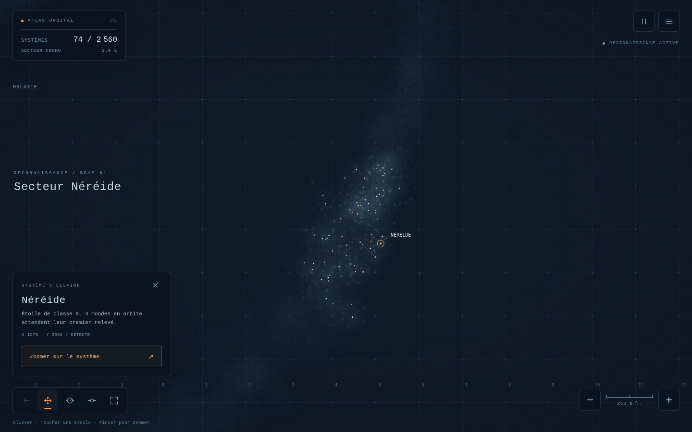 |
| Galaxie entière | 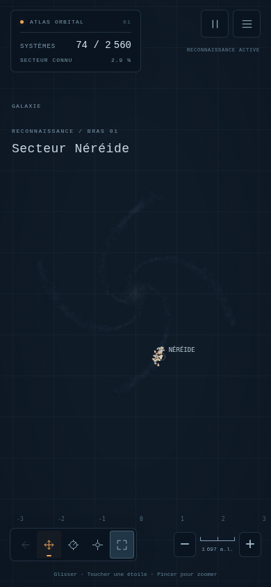 | 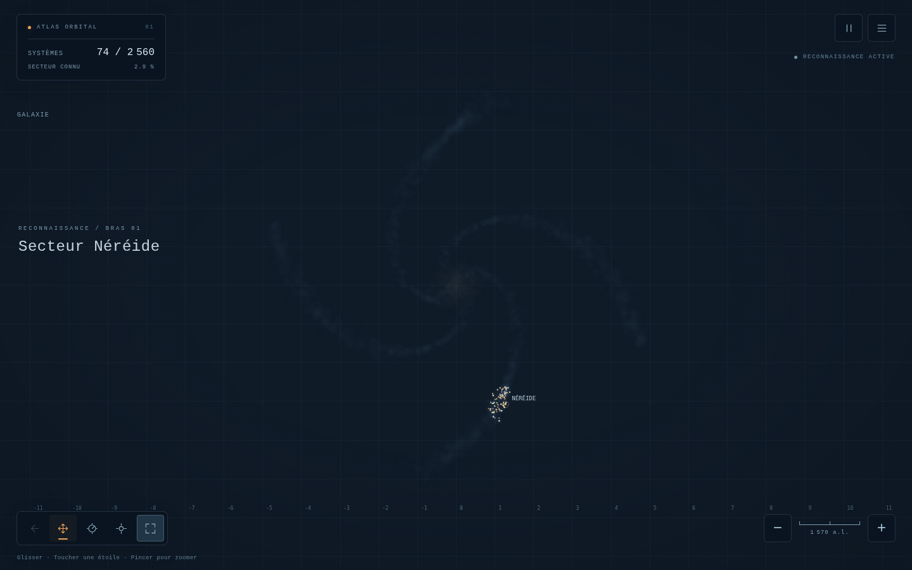 |
| Système | 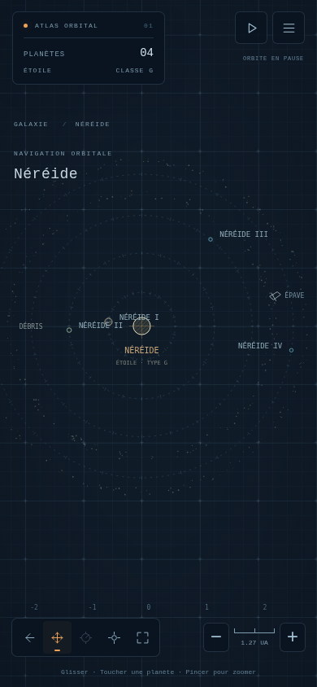 | 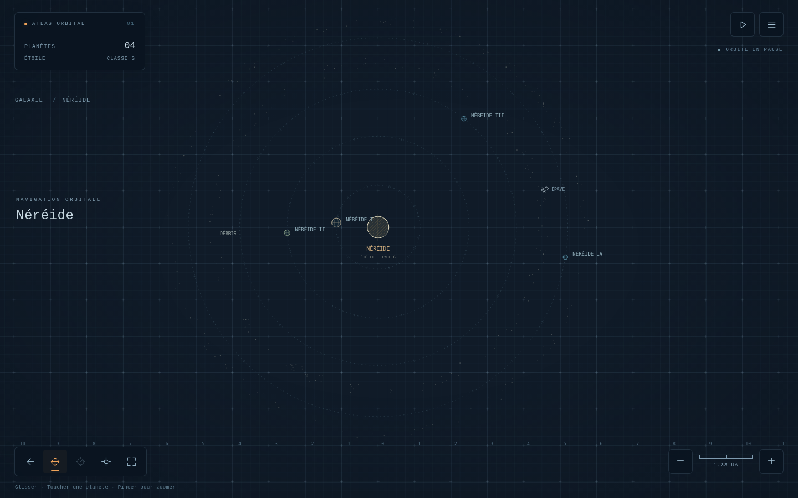 |
| Surface | 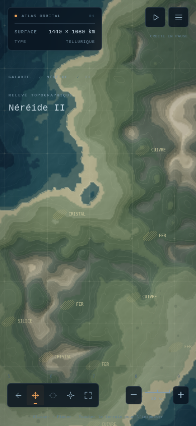 | 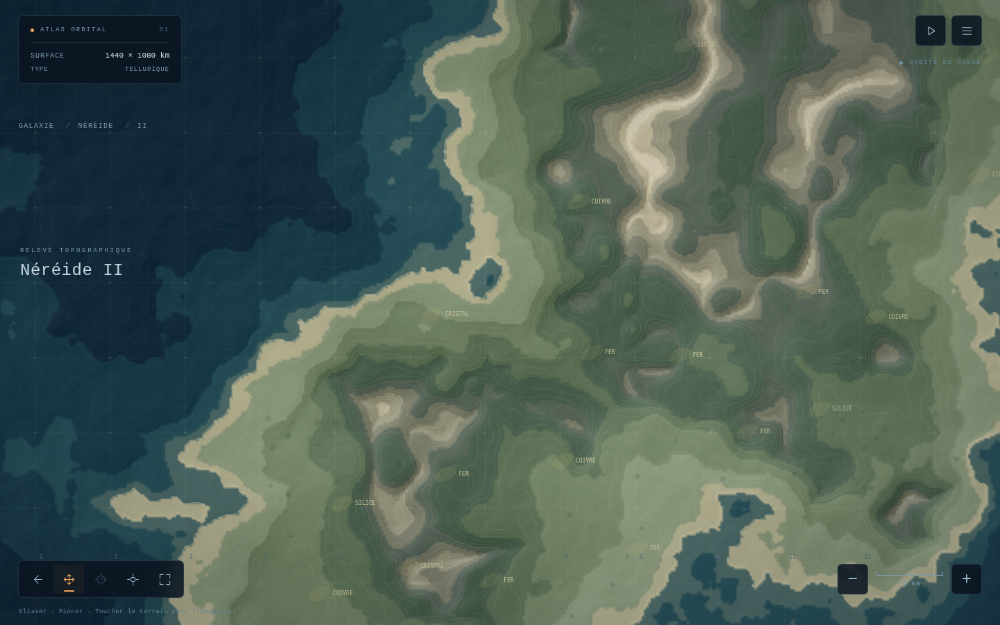 |
| Terrain rapproché | 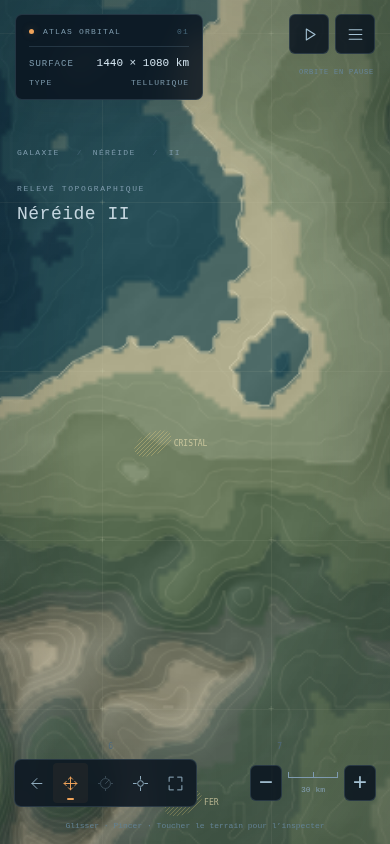 | 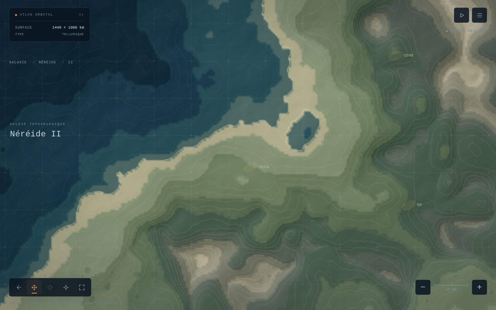 |
| Zoom maximal du terrain | 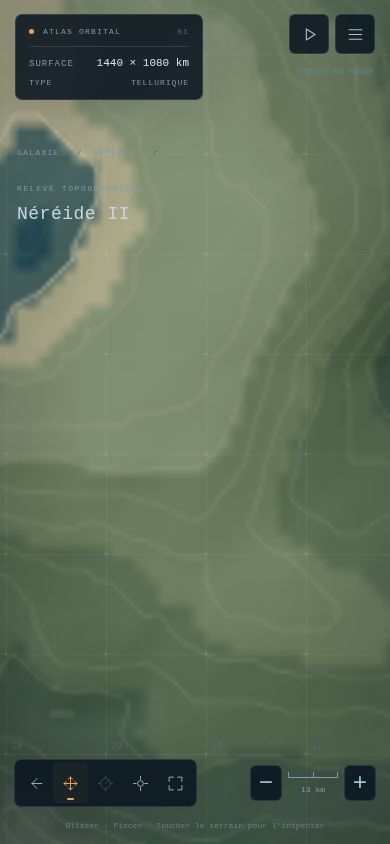 | 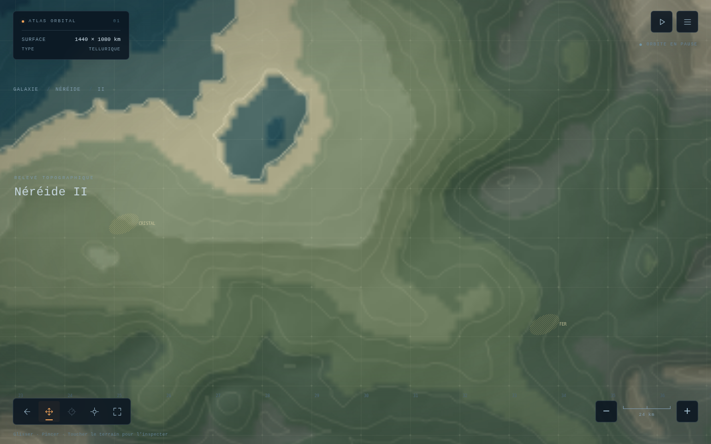 |

## Tous les fichiers

64 captures conservées. Les captures des essais précédents figurent également dans ce dossier.

- [continuous-visual/01-galaxy.png](continuous-visual/01-galaxy.png)
- [continuous-visual/02-galaxy-zoom-4.png](continuous-visual/02-galaxy-zoom-4.png)
- [continuous-visual/03-system.png](continuous-visual/03-system.png)
- [continuous-visual/04-planet-zoom-3.png](continuous-visual/04-planet-zoom-3.png)
- [continuous-visual/04-planet-zoom-5.png](continuous-visual/04-planet-zoom-5.png)
- [continuous-visual/04-planet-zoom-7.png](continuous-visual/04-planet-zoom-7.png)
- [continuous-visual/05-terrain-fit.png](continuous-visual/05-terrain-fit.png)
- [continuous-visual/06-terrain-follow.png](continuous-visual/06-terrain-follow.png)
- [continuous-visual/07-terrain-3x.png](continuous-visual/07-terrain-3x.png)
- [continuous-visual/08-terrain-pan.png](continuous-visual/08-terrain-pan.png)
- [continuous-visual/desktop-terrain-capped.png](continuous-visual/desktop-terrain-capped.png)
- [continuous-visual/mobile-terrain-capped.png](continuous-visual/mobile-terrain-capped.png)
- [desktop-galaxy-overview.png](desktop-galaxy-overview.png)
- [desktop-galaxy-to-system-boundary.png](desktop-galaxy-to-system-boundary.png)
- [desktop-galaxy.png](desktop-galaxy.png)
- [desktop-surface.png](desktop-surface.png)
- [desktop-system-to-surface-boundary.png](desktop-system-to-surface-boundary.png)
- [desktop-system.png](desktop-system.png)
- [desktop-terrain-close.png](desktop-terrain-close.png)
- [final-desktop-galaxy-overview.png](final-desktop-galaxy-overview.png)
- [final-desktop-galaxy.png](final-desktop-galaxy.png)
- [final-desktop-surface.png](final-desktop-surface.png)
- [final-desktop-system.png](final-desktop-system.png)
- [final-mobile-galaxy-overview.png](final-mobile-galaxy-overview.png)
- [final-mobile-galaxy.png](final-mobile-galaxy.png)
- [final-mobile-menu.png](final-mobile-menu.png)
- [final-mobile-startup.png](final-mobile-startup.png)
- [final-mobile-surface.png](final-mobile-surface.png)
- [final-mobile-system.png](final-mobile-system.png)
- [mobile-galaxy-overview.png](mobile-galaxy-overview.png)
- [mobile-galaxy-to-system-boundary.png](mobile-galaxy-to-system-boundary.png)
- [mobile-galaxy.png](mobile-galaxy.png)
- [mobile-menu.png](mobile-menu.png)
- [mobile-startup.png](mobile-startup.png)
- [mobile-surface.png](mobile-surface.png)
- [mobile-system-to-surface-boundary.png](mobile-system-to-surface-boundary.png)
- [mobile-system.png](mobile-system.png)
- [mobile-terrain-close.png](mobile-terrain-close.png)
- [standalone-desktop-galaxy-overview.png](standalone-desktop-galaxy-overview.png)
- [standalone-desktop-galaxy.png](standalone-desktop-galaxy.png)
- [standalone-desktop-surface.png](standalone-desktop-surface.png)
- [standalone-desktop-system.png](standalone-desktop-system.png)
- [standalone-http-desktop-galaxy-overview.png](standalone-http-desktop-galaxy-overview.png)
- [standalone-http-desktop-galaxy-to-system-boundary.png](standalone-http-desktop-galaxy-to-system-boundary.png)
- [standalone-http-desktop-galaxy.png](standalone-http-desktop-galaxy.png)
- [standalone-http-desktop-surface.png](standalone-http-desktop-surface.png)
- [standalone-http-desktop-system-to-surface-boundary.png](standalone-http-desktop-system-to-surface-boundary.png)
- [standalone-http-desktop-system.png](standalone-http-desktop-system.png)
- [standalone-http-desktop-terrain-close.png](standalone-http-desktop-terrain-close.png)
- [standalone-http-mobile-galaxy-overview.png](standalone-http-mobile-galaxy-overview.png)
- [standalone-http-mobile-galaxy-to-system-boundary.png](standalone-http-mobile-galaxy-to-system-boundary.png)
- [standalone-http-mobile-galaxy.png](standalone-http-mobile-galaxy.png)
- [standalone-http-mobile-menu.png](standalone-http-mobile-menu.png)
- [standalone-http-mobile-startup.png](standalone-http-mobile-startup.png)
- [standalone-http-mobile-surface.png](standalone-http-mobile-surface.png)
- [standalone-http-mobile-system-to-surface-boundary.png](standalone-http-mobile-system-to-surface-boundary.png)
- [standalone-http-mobile-system.png](standalone-http-mobile-system.png)
- [standalone-http-mobile-terrain-close.png](standalone-http-mobile-terrain-close.png)
- [standalone-mobile-galaxy-overview.png](standalone-mobile-galaxy-overview.png)
- [standalone-mobile-galaxy.png](standalone-mobile-galaxy.png)
- [standalone-mobile-menu.png](standalone-mobile-menu.png)
- [standalone-mobile-startup.png](standalone-mobile-startup.png)
- [standalone-mobile-surface.png](standalone-mobile-surface.png)
- [standalone-mobile-system.png](standalone-mobile-system.png)
